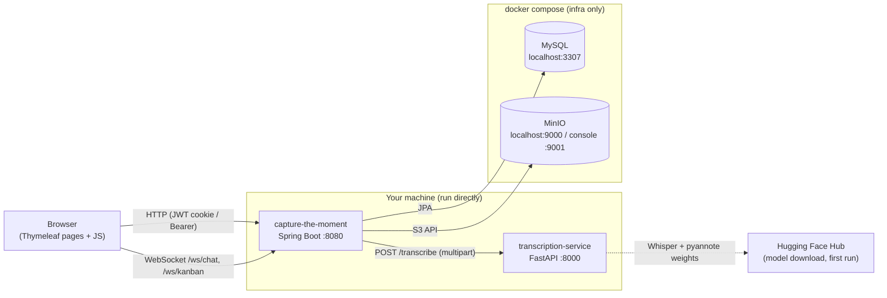
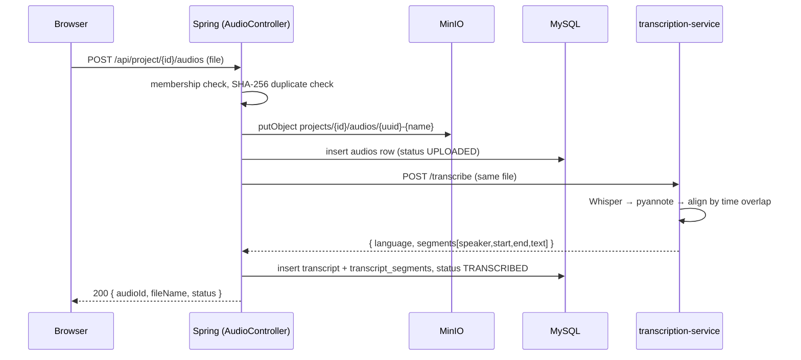

# Capture the Moment

A project-based meeting workspace. Teams create **projects**, upload meeting **audio**, get a **speaker-labelled transcript**, plan work on a real-time **Kanban board**, and talk in a real-time **project chat**.

The system is two microservices plus two infrastructure containers:

| Part | Tech | What it does | Docs |
| --- | --- | --- | --- |
| [`capture-the-moment/`](capture-the-moment/) | Spring Boot 4 · Java 25 · Thymeleaf | The main web app: UI, accounts, projects, audio storage, transcripts, chat, Kanban | [README](capture-the-moment/README.md) |
| [`transcription-service/`](transcription-service/) | FastAPI · Python 3.11 · faster-whisper · pyannote | Stateless speech-to-text + speaker diarization. No database | [README](transcription-service/README.md) |
| MySQL 8.4 (Docker) | | Relational data: users, projects, members, audio metadata, transcripts, chat, tasks | |
| MinIO (Docker) | S3-compatible | Audio file storage | |

---

## Architecture



**Design in one paragraph:** the browser only talks to Spring Boot. Spring owns all state: MySQL for data and MinIO for audio bytes. When audio is uploaded, Spring stores it and then forwards the same file to the Python service. Python runs Whisper (what was said, with timestamps) and pyannote (who spoke when), merges them, and returns JSON. Python stores nothing; temporary files are deleted after each request. Spring saves the transcript segments in MySQL. Chat and Kanban use WebSockets; Spring keeps the open sessions in memory and stores every message and task in MySQL.

### Spring Boot internal layering

```text
controllers  →  services  →  repository  →  entity (JPA, MySQL tables)
   (HTTP)       (rules,        (Spring Data)
                membership)
websocket/   →  services       (chat + kanban real-time handlers)
security/       JWT filter + token utils, wired by configs/SecurityConfig
```

Each layer is split by domain: `user`, `project`, `audio`, `chat`, `kanban`. See [capture-the-moment/README.md](capture-the-moment/README.md#code-layout).

---

## Features

| Feature | How it works |
| --- | --- |
| Accounts | Register / log in with username + password (BCrypt). JWT is stored in an httpOnly cookie `capture_auth`, which is also sent as a Bearer token |
| Projects | Create, rename and delete. The creator becomes `ADMIN` |
| Members | Admins add existing users by username. They join as `MEMBER` |
| Audio | Upload (≤ 2 GB) to MinIO. Duplicate files (same SHA-256) in a project are rejected. Play, download and delete |
| Transcription | Synchronous on upload. Segments come back as `SPEAKER_00`, `SPEAKER_01`, … with start/end times |
| Chat | One room per project over WebSocket, with presence and the last 100 messages as history |
| Kanban | One board per project with `TODO` → `IN_PROGRESS` → `DONE`. Changes reach every member live over WebSocket, and there is also a REST API |
| Account settings | Avatar (image ≤ 2 MB), password change, logout, delete account |

**Not implemented yet:** LLM meeting summaries (the "Summarize" button does nothing), joining a project by invite code, removing members, mapping speaker labels to real names.

---

## Main flows

### 1. Sign up → project

1. `GET /` sends you to `/signin`, or to `/dashboard` if you already have a valid JWT.
2. `POST /auth/signin` registers you. Despite the name, it does not log you in.
3. `POST /auth/login` checks your credentials, sets the `capture_auth` cookie and returns the token.
4. `POST /project` on the dashboard creates the project. You become its `ADMIN` and its Kanban board is created. The chat room is created the first time someone opens chat.

### 2. Audio → transcript (the core flow)



- The request waits for transcription to finish. The read timeout is 45 minutes, and Python runs **one job at a time**.
- The audio is stored **before** transcription starts. If Python is unreachable or times out, Spring returns `503`. If Python returns an error, Spring returns `502` ("audio was saved, but transcription failed"). If Python's response can't be parsed, the audio is marked `TRANSCRIPTION_FAILED`.
- Transcripts are viewed at `/projects/{id}/transcription` and `/projects/{id}/transcription/{audioId}`.

### 3. Real-time chat and Kanban

- Chat is at `/projects/{id}/chit-chat` and connects to `ws://…/ws/chat/{id}`. The server checks membership, sends the history, then broadcasts `message`, `presence` and `system` events.
- Kanban is at `/projects/{id}/kanban` and connects to `ws://…/ws/kanban/{id}`. The client sends `create`, `status` or `delete`. The server saves the change and broadcasts `task-created`, `task-updated` or `task-deleted` to everyone on the board.

### Access rules

Every project API checks that you are a member of that project (`403` otherwise). Renaming or deleting a project and adding members are `ADMIN` only. The Python service has **no authentication**, so keep port 8000 local.

---

## Repository layout

```text
Capture-The-Moment/
├── README.md                 ← you are here (overview, architecture, how to run)
├── docker-compose.yml        ← infra only: mysql, minio, minio-init (creates bucket)
├── docker/mysql-init/        ← SQL run on first MySQL start (creates databases + grants)
├── minio.license             ← required by the MinIO image (not in git)
├── scripts/
│   └── build-and-publish.ps1 ← build + push both Docker images (only when releasing)
├── capture-the-moment/       ← Spring Boot app        → see its README
└── transcription-service/    ← FastAPI transcription  → see its README
```

---

## Running locally

Docker runs **only MySQL and MinIO**. The two services run directly on your machine, so a code change needs only a restart, with no image rebuild or publish.

### Prerequisites

- Docker Desktop (with Compose)
- JDK 25 (Maven is provided through the wrapper `mvnw`)
- Python 3.11
- A `minio.license` file in the repo root
- A Hugging Face **read** token, and access accepted on [pyannote/speaker-diarization-community-1](https://huggingface.co/pyannote/speaker-diarization-community-1). See the [transcription-service README](transcription-service/README.md#hugging-face-access-required-for-speaker-labels)

### 1. Start the infrastructure (once; it keeps running)

```powershell
docker compose up -d
```

| Service | Address | Credentials |
| --- | --- | --- |
| MySQL | `localhost:3307`, database `myapp_local` | `spring` / `spring` (root: `root`) |
| MinIO S3 API | http://localhost:9000, bucket `capture-the-moment-local` | `admin` / `admin12345` |
| MinIO console | http://localhost:9001 | `admin` / `admin12345` |

### 2. Start the transcription service (terminal 1)

```powershell
cd transcription-service
python -m venv .venv
.venv\Scripts\activate
pip install -r requirements.txt
copy .env.example .env        # then put your real HF_TOKEN in .env
uvicorn app.main:app --reload --port 8000 --reload-exclude uploads --reload-exclude .venv
```

The models download on the first transcription, which can take a few minutes.

### 3. Start the Spring Boot app (terminal 2)

```powershell
cd capture-the-moment
.\mvnw.cmd spring-boot:run "-Dspring-boot.run.profiles=local"
```

### 4. Use it

Open **http://localhost:8080**. Register, log in, create a project, then upload a short `.wav` or `.mp3` under **Audios** and open **Transcription**.

### Stop

- Press `Ctrl+C` in the two terminals.
- Run `docker compose down` to stop the infrastructure. Your data stays in Docker volumes; add `-v` only if you want to wipe it.

---

## Docker images (when releasing)

Images are **not** part of the development loop. Both services have a `Dockerfile`, and `application-docker.properties` holds the in-network hostnames (`mysql`, `minio`, `transcription-service`) for when the apps run as containers. To publish both images at once:

```powershell
docker login
.\scripts\build-and-publish.ps1
```

---

## Security notes (development defaults)

- The default passwords in `docker-compose.yml` and `application-local.properties` and the default JWT secret are for local use only. Set `JWT_SECRET` (≥ 32 bytes) anywhere else.
- CSRF is disabled and the auth cookie is not `Secure` (plain HTTP on localhost).
- Keep `.env`, `minio.license` and any tokens out of git (`.gitignore` already covers them).
