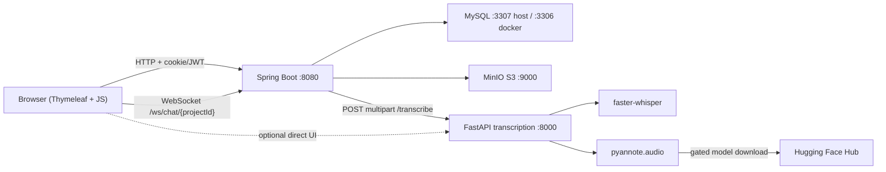
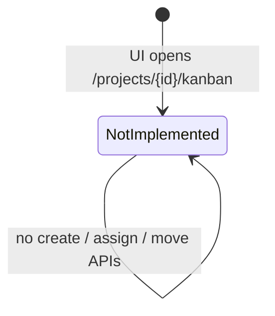
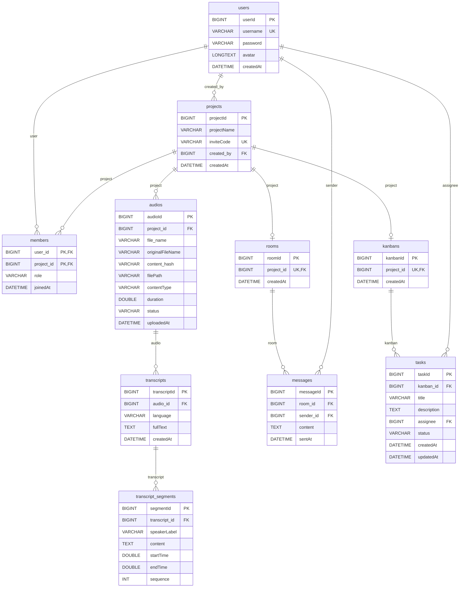
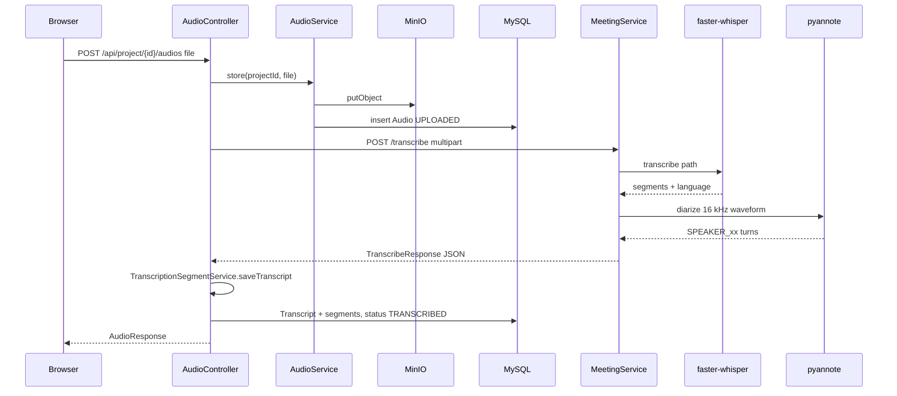

# Capture the Moment

A project-based meeting workspace: users create projects, upload audio, transcribe it with speaker labels, review transcripts, chat in real time, and manage members. The product is a **Thymeleaf web app** backed by **Spring Boot**, **MySQL**, **MinIO**, and a separate **FastAPI transcription service** (faster-whisper + pyannote).

This README documents **the implementation that exists in this repository**. Features that appear only as UI placeholders, unused entities, or incomplete Docker wiring are called out explicitly.

### Contents

1. [Project Overview](#project-overview)
2. [Problem Statement](#problem-statement)
3. [Key Features](#key-features)
4. [Repository Structure](#repository-structure)
5. [System Architecture](#system-architecture)
6. [Technology Stack](#technology-stack)
7. [Core Components and Responsibilities](#core-components-and-responsibilities)
8. [User Interface Map](#user-interface-map)
9. [Detailed Feature Documentation](#detailed-feature-documentation)
10. [End-to-End Workflows](#end-to-end-workflows)
11. [Access Control Rules](#access-control-rules)
12. [Task Lifecycle](#task-lifecycle)
13. [Audio Transcription Pipeline](#audio-transcription-pipeline)
14. [AI-Powered Meeting Analysis](#ai-powered-meeting-analysis)
15. [API Reference](#api-reference)
16. [Database Schema and Data Models](#database-schema-and-data-models)
17. [Authentication and Authorization](#authentication-and-authorization)
18. [Asynchronous Processing and Error Handling](#asynchronous-processing-and-error-handling)
19. [Configuration Reference](#configuration-reference)
20. [Prerequisites](#prerequisites)
21. [Local Development Setup](#local-development-setup)
22. [Docker Setup](#docker-setup)
23. [Running the Application](#running-the-application)
24. [Testing](#testing)
25. [Logging and Debugging](#logging-and-debugging)
26. [Troubleshooting](#troubleshooting)
27. [Security Considerations](#security-considerations)
28. [Performance and Resource Requirements](#performance-and-resource-requirements)
29. [Known Limitations](#known-limitations)
30. [Future Improvements](#future-improvements)
31. [Contributing Guidelines](#contributing-guidelines)
32. [License](#license)

---

## Project Overview

Capture the Moment is a local/self-hosted application for storing meeting audio and turning it into a speaker-segmented transcript.

- **`capture-the-moment/`** is the main application: authentication, projects, object storage, persistence, Thymeleaf pages, REST APIs, and a proxy to Python.
- **`transcription-service/`** is a Python HTTP service: it accepts an audio file, runs Whisper transcription and pyannote diarization, aligns the two, and returns JSON. It has **no database**.
- **`docker/`** currently contains only a MySQL init script used by Docker Compose.
- Root **`docker-compose.yml`** starts **MySQL 8.4** and **MinIO**. It does **not** currently define Spring Boot or Python as Compose services.

There is **no LLM integration** in the codebase (no summaries, action-item extraction, or structured meeting insights from a language model). A “Summarize” button exists on the transcription list page and does nothing.

---

## Problem Statement

Teams record meetings and then lose the content in unstructured audio files. This project stores those files per project, transcribes them with timestamps and anonymous speaker labels (`SPEAKER_00`, …), and keeps the result next to project membership and chat. Task boards and AI summaries are **not implemented** yet, even though some UI and tables exist.

---

## Key Features

| Feature | Status in code |
| --- | --- |
| Username/password accounts, JWT cookie + Bearer token | Implemented |
| Project create / rename / delete (admin) | Implemented |
| Add members by existing username (admin) | Implemented |
| Invite codes stored on projects | Generated; **no join-by-code API** |
| Audio upload to MinIO, SHA-256 duplicate detection | Implemented |
| Synchronous transcription via Python | Implemented |
| Transcript + speaker segments persisted in MySQL | Implemented |
| Play/download audio, delete audio + transcript | Implemented |
| Project chat (WebSocket + last 100 messages) | Implemented |
| Account avatar, password change, logout, delete account | Implemented |
| Kanban / tasks | **Entities + placeholder page only** |
| Meeting summary / LLM analysis | **Not implemented** |
| Speaker identity (real names) | **Not implemented** (anonymous cluster IDs only) |
| Full Docker Compose of app + Python | **Not in current `docker-compose.yml`** |

---

## Repository Structure

```text
Capture-The-Moment/
├── README.md                          # This file
├── .env.example                       # HF_TOKEN, WHISPER_MODEL (Python; also Compose interpolation)
├── .gitignore
├── docker-compose.yml                 # mysql, minio, minio-init only
├── docker-compose.gpu.yml             # override fragment for a transcription-service GPU reservation
├── build_and_publish.ps1              # Image build/push helper (expects a Compose profile that is not in the current compose file)
├── docker/
│   └── mysql-init/init.sql            # Creates myapp_local and myapp_docker; grants spring user
├── capture-the-moment/                # Spring Boot 4.1.1, Java 21
│   ├── Dockerfile
│   ├── pom.xml
│   ├── mvnw / mvnw.cmd
│   ├── garage.toml                    # Unused by current Compose (MinIO is used instead)
│   └── src/main/
│       ├── java/com/example/capture_the_moment/
│       └── resources/
│           ├── application.properties
│           ├── application-local.properties
│           ├── application-docker.properties
│           ├── templates/             # Thymeleaf UI
│           └── static/js/auth.js
└── transcription-service/             # FastAPI 0.3.0
    ├── Dockerfile
    ├── README.md                      # Service-specific notes (gated HF model)
    ├── requirements.txt
    ├── run.txt                        # Local notes / AMI corpus wget examples
    └── app/
        ├── main.py
        ├── controllers/
        ├── models/
        ├── services/
        └── views/index.html
```

Additional documentation lives in `transcription-service/README.md`. This root README is the full project map.

---

## System Architecture



**Local vs Docker hostnames**

| Client | Target | Local (`local` profile) | Docker profile properties (`application-docker.properties`) |
| --- | --- | --- | --- |
| Spring | MySQL | `localhost:3307` / DB `myapp_local` | hostname `mysql:3306` / DB `myapp_docker` |
| Spring | MinIO | `http://localhost:9000` | `http://minio:9000` |
| Spring | Python | `http://localhost:8000` | `http://transcription-service:8000` |

`localhost` is correct when Spring and Python run **on the host** and only MySQL/MinIO are in Compose. It is **not** valid for container-to-container calls; those must use Compose service names. The current Compose file does not start Spring or Python, so the docker profile is unused unless you run those images yourself.

---

## Technology Stack

| Layer | Technology | Purpose | Where it is used |
| --- | --- | --- | --- |
| Web UI | Thymeleaf + inline JS | Pages and fetch/WebSocket clients | `src/main/resources/templates/` |
| Frontend auth helper | `static/js/auth.js` | Stores JWT in `localStorage`, injects `Authorization: Bearer` | All authenticated pages |
| Backend | Spring Boot **4.1.1**, Spring MVC, Security, Data JPA, WebSocket | App server | `capture-the-moment/` |
| Reactive starter | `spring-boot-starter-webflux` | On the classpath; **no reactive controllers**. HTTP clients use `RestClient` | `pom.xml` |
| Language | **Java 21** | Spring service | `pom.xml` `<java.version>` |
| Language | **Python 3.11** (Docker base `python:3.11-slim`) | Transcription service | `transcription-service/Dockerfile` |
| Build | Maven Wrapper **3.9.16** (`wrapperVersion` 3.3.4) | Build/run Spring | `capture-the-moment/.mvn/wrapper/` |
| Persistence | MySQL **8.4** + Hibernate `ddl-auto=update` | Schema and data | Compose + JPA entities |
| Object storage | MinIO Java SDK **8.5.17**; Compose image `quay.io/minio/aistor/minio:latest` | Audio blobs | `MinioConfig`, `AudioService` |
| Auth | Spring Security + JJWT **0.12.6** + BCrypt | JWT HS256, cookie `capture_auth` | `SecurityConfig`, `JwtFilter`, `JwtUtils` |
| Transcription | **faster-whisper** `>=1.1.0,<2.0.0` | Speech-to-text + segment times + language | `TranscriptionService` |
| Diarization | **pyannote.audio** `>=4.0.0,<5.0.0`, pipeline `pyannote/speaker-diarization-community-1` | Anonymous speaker turns | `DiarizationService` |
| Audio decode | **PyAV** `>=11,<16`, **ffmpeg** in Docker, `faster_whisper.audio.decode_audio` | Decode/resample to 16 kHz for diarization | Dockerfile + `DiarizationService` |
| DL runtime | **torch** `>=2.8.0,<3.0.0` | CUDA if available, else CPU | `config.py`, diarization `.to(device)` |
| Python API | FastAPI + Uvicorn + python-multipart | HTTP API | `app/main.py` |
| Inter-service | HTTP multipart `POST /transcribe` | Spring `RestClient` (20s connect, 45 min read) | `AudioController` |
| Containerization | Dockerfiles for both apps; Compose for MySQL + MinIO | Packaging / local infra | see Docker section |
| Testing | JUnit via `spring-boot-starter-webmvc-test` | Single `contextLoads` test | `CaptureTheMomentApplicationTests` |
| LLM | — | — | **Not present** |

**Direct Python packages (from `requirements.txt`):** FastAPI, Uvicorn, faster-whisper, python-multipart, python-dotenv, av (pinned `<16` because faster-whisper 1.x uses `av.open(..., metadata_errors=...)`), torch, pyannote.audio.

---

## Core Components and Responsibilities

### Spring Boot (`com.example.capture_the_moment`)

| Component | Responsibility |
| --- | --- |
| `CaptureTheMomentApplication` | `@SpringBootApplication` entry point |
| `SecurityConfig` | Permit `/`, `/signin`, `/auth/signin`, `/auth/login`, `/js/**`, `/css/**`; authenticate everything else; CSRF off; stateless sessions; JWT filter; BCrypt |
| `JwtFilter` | Read `Authorization: Bearer` or cookie `capture_auth`; load user; set `SecurityContext` |
| `JwtUtils` | HS256 JWT; subject = username; default TTL `PT8H`; secret must be ≥ 32 bytes |
| `AuthService` | Registration, `UserDetailsService`, password change, avatar (Base64 data URL), account delete |
| `AuthController` | `/auth/*` HTTP |
| `UserController` | `GET /u/me` → `{ username }` |
| `ViewController` | Thymeleaf routes |
| `ProjectController` / `ProjectService` | Projects and membership listing |
| `InviteService` | Admin adds an **existing** user as `MEMBER` |
| `AudioController` / `AudioService` | Upload, MinIO, list, delete, stream, proxy transcribe |
| `TranscriptionSegmentService` | Parse Python JSON and persist `Transcript` / `TranscriptSegment`; unique file names |
| `TranscriptionSegmentController` | List audios with transcripts for a project |
| `ChatController` / `ChatService` | Chat history REST; persist messages; membership checks |
| `WebSocketConfig` + `ChatWebSocketHandler` | `/ws/chat/{projectId}` |
| `ChatHandshakeInterceptor` | Copy `projectId` from path into session attributes |
| `MinioConfig` | `MinioClient` bean |
| `ApiExceptionHandler` | Upload size, missing part, `ResponseStatusException` → `{ error, message }` |
| `HealthController` | Test-only health strings / Python proxy |
| `WebClientController` | Test-only `GET /client?q=` → hardcoded `http://localhost:8000/query` |
| `UserService` | **Empty class, unused** |

Package layout: `controllers` (user, project, audio, views, exceptions), `services`, `repository`, `entity`, `configs`, `filters`, `utils`.

### Python (`transcription-service/app`)

| Component | Responsibility |
| --- | --- |
| `main.py` | FastAPI app v0.3.0, lifespan, attach `MeetingService` |
| `config.py` | Paths, allowed extensions, Whisper/device/compute, HF token helpers |
| `MeetingService` | One global lock: save file → Whisper → pyannote → align → delete temp file |
| `StorageService` | Validate extension, write `uploads/`, delete after request |
| `TranscriptionService` | Lazy-load `WhisperModel`; `transcribe()` |
| `DiarizationService` | Lazy-load gated pyannote pipeline; decode 16 kHz; speaker turns |
| `AlignmentService` | Assign speaker by maximum timestamp overlap |
| `hf_auth.py` | Validate `HF_TOKEN`, `whoami`, `model_info` before download |
| Controllers | `/`, `/query`, `/health`, `/transcribe` |

---

## User Interface Map

The Spring app is server-rendered Thymeleaf. Behavior is mostly inline `<script>` plus `static/js/auth.js`. There is **no** `/css` directory; `SecurityConfig` still permits `/css/**`.

| Page | Template | Primary APIs it calls |
| --- | --- | --- |
| Sign in / register | `signin.html` | `POST /auth/login`, `POST /auth/signin` |
| Dashboard | `dashboard.html` | `GET /project`, `POST /project` |
| Account settings | `settings.html` | `POST /auth/account/avatar`, `POST /auth/account/password`, `POST /auth/logout`, `DELETE /auth/account` |
| Project settings (admin UI) | `project-settings.html` | `GET /project`, `PATCH /project/{id}`, `DELETE /project/{id}` |
| Audios | `project-audios.html` | `GET/POST/DELETE /api/project/{id}/audios`, content URL for `<audio>` |
| Transcription list | `project-transcription.html` | `GET /api/project/{id}/transcriptions` |
| Transcription detail | `transcription-detail.html` | `GET /api/project/{id}/audios/{audioId}/transcription` |
| Kanban | `project-kanban.html` | **None** (placeholder copy) |
| Chit-chat | `project-chit-chat.html` | `GET /u/me`, WebSocket `/ws/chat/{id}` |
| Members | `project-members.html` | `GET /project`, `GET/POST /project/{id}/members` |
| Shell nav | `fragments/project-shell.html` | Links only |

**Unused Spring template:** `templates/index.html` is a leftover upload/query page. `ViewController` never returns `"index"` (`GET /` redirects). If it were served, upload would `POST http://localhost:8080/api/transcribe` (hardcoded host) and the query form would `GET /query`, which **does not exist** on Spring (Python exposes `/query`; Spring exposes `GET /client?q=`).

**Python UI:** `app/views/index.html` is served at `GET /` on port 8000. Upload posts to `/transcribe`; the query form calls `/query`.

---

## Detailed Feature Documentation

### Accounts and session

- **Create account** is `POST /auth/signin` (name is historical; it **registers**, it does not log in).
- **Log in** is `POST /auth/login`. Success sets httpOnly cookie `capture_auth` (`Secure=false`, `SameSite=Lax`, path `/`, max-age **8 hours** in the cookie builder) and returns JSON including `token` and `redirect: /dashboard`.
- The sign-in page stores `token` in `localStorage` key `capture_auth_token` and `auth.js` sends it as Bearer on same-origin `fetch`.
- All authenticated users get Spring role `USER`. Project `ADMIN` / `MEMBER` is a **separate** string on `members.role`.

### Projects and members

- Creating a project assigns a UUID `inviteCode` and inserts the creator as `ADMIN`.
- Admins can `PATCH` the name (≤ 100 characters after trim) and `DELETE` the project.
- Delete currently: wipe chat messages + room, delete memberships, delete the project row. It does **not** delete MinIO objects or audio/transcript rows. If audios exist, MySQL FK constraints may prevent delete. **Not verified beyond the service method.**
- Admins add members by **username of an existing account**. There is no invite-link redemption and no remove-member API.

### Audio and transcription (product path)

The UI “Upload and transcribe” calls `POST /api/project/{projectId}/audios` (not `/api/transcribe`).

### Chat

- One `Room` per project, created on first history/connect.
- WebSocket events: `history`, `message`, `presence`, `system`, `error`.
- Messages capped at 2,000 characters; history is last 100 by `sentAt`/`messageId`.

### Kanban

`Kanban` and `Task` JPA entities exist so Hibernate may create `kanbans` and `tasks` tables. There are **no** repositories, services, or REST endpoints. `project-kanban.html` states the board is not available.

### Avatars

Stored as a `data:{contentType};base64,...` string in `users.avatar` (`LONGTEXT`). Max 2 MB, `Content-Type` must start with `image/`.

---

## End-to-End Workflows

### A. Register, log in, create a project

1. Browser `GET /` → redirect `/signin` or `/dashboard` depending on JWT.
2. `POST /auth/signin` with `{ username, password }` → 201 if username free, password ≥ 8 chars, BCrypt stored.
3. `POST /auth/login` → `AuthenticationManager` + JWT.
4. Dashboard `POST /project` `{ "projectName": "..." }` → `ProjectService.createProject`.

### B. Project audio → transcript (main product workflow)

This is the implemented pipeline (not async; the HTTP request waits for Python, up to **45 minutes** read timeout):

```text
Browser POST /api/project/{id}/audios  (multipart field "file")
        │
        ▼
AudioController.uploadProjectAudio
        │  membership check via findAudios()
        ▼
AudioService.store
        │  empty file → 400
        │  missing project → 404
        │  SHA-256 duplicate in project → 409
        │  unique display name; object key projects/{id}/audios/{uuid}-{name}
        │  MinIO put; Audio row status UPLOADED
        ▼
RestClient POST {transcription.service.url}/transcribe  (same file)
        │
        ▼
MeetingService.transcribe_upload  (global lock)
        │  save temp file → Whisper → pyannote → overlap merge → delete temp
        ▼
JSON TranscribeResponse
        ▼
TranscriptionSegmentService.saveTranscript
        │  persist Transcript + segments; status TRANSCRIBED
        │  on parse failure: status TRANSCRIPTION_FAILED, throw → 502
        ▼
200 AudioResponse { audioId, fileName, status, uploadedAt }
```

**If Python is down or times out:** 503, message that the transcription service is unavailable. **Audio may already be stored** (upload happens first).

**If Python HTTP/client fails after store:** 502, “The audio was saved, but transcription failed.”

Python validation errors (400 unsupported type, 403 HF token/gated model) surface as `RestClientException` and are currently mapped to **502** on this project endpoint (the controller does not forward Python’s status the way `/api/transcribe` does).

### C. Standalone proxy transcription (not used by the project UI)

`POST /api/transcribe`:

1. Reject empty file (400).
2. `AudioService.storeForTranscription` — MinIO key `transcriptions/{uuid}-{name}` (**no** `Audio` row).
3. Proxy Python `POST /transcribe` and **return Python’s status, headers, and body as-is**.
4. Does **not** persist a transcript in MySQL.

### D. Review transcripts

- List: `GET /api/project/{projectId}/transcriptions`
- Detail page: `GET /api/project/{projectId}/audios/{audioId}/transcription`

`fullText` is filled from JSON field `text`. Python’s `TranscribeResponse` **does not include `text`**, only `segments`. The UI therefore typically shows **segments only**, unless something else adds `text`. Concatenated full text is **not** built in Java.

### E. Chat

1. Page loads `GET /u/me`, then `ws://{host}/ws/chat/{projectId}` (cookie/JWT on handshake).
2. Handler checks membership; on failure closes with 403.
3. Sends history; broadcasts join/leave and presence.
4. Client sends `{ "content": "..." }`; server saves and broadcasts `type: message`.

### F. Direct Python UI

FastAPI serves `GET /` (`app/views/index.html`) for uploading a file straight to `/transcribe`. This bypasses Spring, MySQL, and MinIO.

---

## Access Control Rules

Enforced in application code (not Spring method security). Failure is typically HTTP 403 with a `ResponseStatusException` reason.

| Action | Who can do it | How it is checked |
| --- | --- | --- |
| List own projects | Any authenticated user | `Member` rows for that username |
| Create project | Any authenticated user | Becomes `ADMIN` of the new project |
| Rename / delete project | Project `ADMIN` | `ProjectService.requireAdmin` |
| List / add members | List: any member. Add: `ADMIN` | `requireMembership` / `InviteService` |
| Upload / list / stream / delete audio | Any project member | `AudioService.requireMember` |
| Read transcripts | Any project member | Same, then transcript lookup |
| Chat history + WebSocket | Any project member | `ChatService.requireMembership` |
| Account avatar / password / delete | The authenticated principal | Username from JWT |
| Python `/transcribe` | Anyone who can reach port 8000 | **No auth** |

Pages under `/projects/{id}/...` are only “authenticated user”; they do **not** verify membership in `ViewController`. The APIs the page then calls do. A non-member can open the HTML shell and then see API errors.

`inviteCode` is returned on `ProjectResponse` to every member (including non-admins via `from(Member)`). It is not used as a capability token.

---

## Task Lifecycle

**Not implemented as a workflow.** Hibernate may create `kanbans` and `tasks` because of the entities. No code creates a `Kanban` when a project is created. `Task.status` is an unconstrained `String`; there is no enum and no transition logic.



The placeholder page states that task-management endpoints have not been implemented.

---

## Audio Transcription Pipeline

### What Spring does

- Multipart max **2 GB** (`spring.servlet.multipart`).
- Stores bytes in MinIO; metadata in `audios`.
- Forwards the original multipart file to Python.
- Maps segment JSON: `speaker`/`speakerLabel`, `text`/`content`, `start`/`startTime`, `end`/`endTime`.

No resampling, format conversion, or duration calculation in Java. `Audio.duration` is never set.

### What Python does

1. **Accept** `.mp3`, `.wav`, `.m4a`, `.flac`, `.ogg` only (`ALLOWED_EXTENSIONS`). No duration cap in code.
2. **Write** `transcription-service/uploads/{uuid}_{originalName}`.
3. **Whisper** (`faster_whisper.WhisperModel`):
   - Model id: env `WHISPER_MODEL`, default **`base`**.
   - Device: `cuda` if `torch.cuda.is_available()` else `cpu`.
   - Compute type: **`float16` on GPU**, **`int8` on CPU**.
   - `transcribe(file_path)` with **no language argument** (model language detection).
   - Segment `start`/`end` rounded to 2 decimals; `text` stripped.
   - **No word-level timestamps** requested.
4. **Diarization** (`pyannote/speaker-diarization-community-1`):
   - Requires `HF_TOKEN` or `HUGGING_FACE_HUB_TOKEN`, account access to the gated repo, then `Pipeline.from_pretrained`.
   - Audio decoded with `faster_whisper.audio.decode_audio(..., sampling_rate=16000)` (PyAV; avoids torchcodec path issues on Windows).
   - Pipeline moved to the same device as Whisper.
   - Labels normalized to `SPEAKER_00`, `SPEAKER_01`, … or `UNKNOWN`.
   - Uses `exclusive_speaker_diarization` when present, else `speaker_diarization` / iterable turns.
5. **Alignment**: for each Whisper segment, pick the diarization turn with the largest time overlap; if none, `UNKNOWN`.
6. **Response** does **not** include a concatenated transcript string.
7. **Cleanup**: temp file deleted in `finally`.
8. **Concurrency**: `threading.Lock` — **one transcription at a time** per process.
9. **Lazy load**: Whisper and pyannote load on the **first** `POST /transcribe`, not at process start.
10. **`.env` location**: `load_dotenv` uses `transcription-service/.env` (`PROJECT_ROOT` = two parents up from `app/services/config.py`), **not** the repository root `.env` unless you copy/link it.

There is **no streaming transcription**, no speaker enrollment, and no identification of real people.

---

## AI-Powered Meeting Analysis

**Not implemented.** No OpenAI/Anthropic/local LLM client, no prompt templates, no summary tables.

`project-transcription.html` has a Summarize button with an empty click handler.

---

## API Reference

Unless noted, Spring endpoints require a valid JWT (cookie or `Authorization: Bearer`). Unauthenticated browser requests are redirected to `/signin` (`LoginUrlAuthenticationEntryPoint`). JSON API clients typically receive 401/redirect depending on the client.

Error body from `ApiExceptionHandler` (and many services via `ResponseStatusException`):

```json
{
  "error": "bad_request",
  "message": "Project name is required."
}
```

`ResponseStatusException` `reason` is returned as `message`. FastAPI errors use `{"detail": "..."}`.

### Spring Boot — pages (`ViewController`)

| Method | Path | Auth | Purpose |
| --- | --- | --- | --- |
| GET | `/` | Public | Redirect to `/dashboard` or `/signin` |
| GET | `/signin` | Public | Login/register page |
| GET | `/dashboard` | Required | Project list/create |
| GET | `/settings` | Required | Account settings |
| GET | `/projects/{projectId}/settings` | Required | Admin project settings UI |
| GET | `/projects/{projectId}/audios` | Required | Audio UI |
| GET | `/projects/{projectId}/transcription` | Required | Transcript list UI |
| GET | `/projects/{projectId}/transcription/{audioId}` | Required | Transcript detail UI |
| GET | `/projects/{projectId}/kanban` | Required | Placeholder Kanban UI |
| GET | `/projects/{projectId}/chit-chat` | Required | Chat UI |
| GET | `/projects/{projectId}/members` | Required | Members UI |

`templates/index.html` is **not** mapped by `ViewController`.

### Spring Boot — auth and user

#### `POST /auth/signin` — register (public)

```json
{ "username": "alice", "password": "at-least-8" }
```

| Status | Meaning |
| --- | --- |
| 201 | `{ "message": "Account created successfully.", "user": { "id": 1, "username": "alice" } }` |
| 400 | Missing fields or password too short |
| 409 | Username taken |

Does **not** issue a JWT.

#### `POST /auth/login` — login (public)

Same JSON body.

| Status | Meaning |
| --- | --- |
| 200 | `{ "message": "Logged in successfully.", "redirect": "/dashboard", "token": "<jwt>" }` + `Set-Cookie: capture_auth=` |
| 401 | `{ "message": "Invalid username or password." }` |

#### `POST /auth/account/avatar` (authenticated)

`multipart/form-data` field `avatar`. 200 `{ "message": "Avatar updated successfully." }` or 400/500 with `message`.

#### `POST /auth/account/password` (authenticated)

```json
{ "currentPassword": "...", "newPassword": "at-least-8" }
```

#### `POST /auth/logout` (authenticated)

Clears cookie (`Max-Age=0`), invalidates HTTP session if present, `{ "message": "Logged out successfully." }`.

#### `DELETE /auth/account` (authenticated)

Deletes the `users` row, clears security context, invalidates session. **Does not** cascade-delete projects/memberships in application code. FK behavior is Hibernate/MySQL default. **Not verified** for orphan/constraint failures.

#### `GET /u/me`

```json
{ "username": "alice" }
```

### Spring Boot — projects

#### `GET /project`

Array of `ProjectResponse`: `projectId`, `projectName`, `inviteCode`, `createdAt`, `createdBy`, `role`, `admin`.

#### `POST /project` → 201

```json
{ "projectName": "Sprint planning" }
```

#### `PATCH /project/{projectId}` — admin

Same body. 403 if not admin / not a member.

#### `DELETE /project/{projectId}` — admin

`{ "message": "Project deleted successfully." }`

#### `GET /project/{projectId}/members`

`[{ "userId", "username", "role", "joinedAt" }]`

#### `POST /project/{projectId}/members` — admin → 201

```json
{ "username": "bob" }
```

400 empty username; 404 unknown user; 409 already a member; 403 not admin.

### Spring Boot — audio and transcripts

#### `POST /api/project/{projectId}/audios`

`multipart/form-data` field **`file`**. Caller must be a member.

Success 200:

```json
{
  "audioId": 12,
  "fileName": "standup.wav",
  "status": "TRANSCRIBED",
  "uploadedAt": "2026-10-26T21:15:00"
}
```

(Example timestamps.) Status may remain `UPLOADED` if you inspect the row after a 502/503.

#### `GET /api/project/{projectId}/audios`

List of `AudioResponse`.

#### `DELETE /api/project/{projectId}/audios/{audioId}` → 204

Removes MinIO object, segments, transcript, audio row. 502 if MinIO delete fails (DB not deleted in that case).

#### `GET /api/project/{projectId}/audios/{audioId}/content`

Streams MinIO bytes; `Content-Type` from `audios.content_type`.

#### `GET /api/project/{projectId}/audios/{audioId}/transcription`

```json
{
  "transcriptId": 3,
  "fileName": "standup.wav",
  "language": "en",
  "text": null,
  "createdAt": "2026-10-26T21:16:00",
  "segments": [
    {
      "speaker": "SPEAKER_00",
      "text": "Let's start.",
      "start": 0.0,
      "end": 1.8
    }
  ]
}
```

`text` is null when Python omits root `text` (current Python schema). 404 if no transcript yet.

#### `GET /api/project/{projectId}/transcriptions`

Per audio: `audioId`, `fileName`, `status`, `language`, `text`, `segments` (empty list if no transcript).

#### `POST /api/transcribe`

Authenticated. Multipart `file`. Proxies Python. 400 empty; 502 MinIO store failure; 503 Python unreachable.

### Spring Boot — chat

#### `GET /project/{projectId}/chat/history`

```json
{
  "messages": [
    {
      "messageId": 1,
      "username": "alice",
      "content": "Hello",
      "sentAt": "2026-10-26T21:20:00"
    }
  ]
}
```

#### WebSocket ` /ws/chat/{projectId}`

Client → `{ "content": "Hello" }`

Server examples:

```json
{ "type": "history", "messages": [ ] }
```

```json
{ "type": "message", "message": { "messageId": 2, "username": "alice", "content": "Hello", "sentAt": "..." } }
```

```json
{ "type": "presence", "users": ["alice", "bob"] }
```

```json
{ "type": "system", "message": "alice joined the chat" }
```

### Spring Boot — test endpoints (require auth)

| Method | Path | Behavior |
| --- | --- | --- |
| GET | `/api/health` | Returns a hardcoded plaintext test string (not a JSON health document) |
| GET | `/api/health/py` | `GET {transcription.service.url}/health`, returns Python body |
| GET | `/client?q=` | `GET http://localhost:8000/query?query=` (ignores `transcription.service.url`) |

### Python transcription service (no auth)

| Method | Path | Purpose |
| --- | --- | --- |
| GET | `/` | Upload HTML |
| GET | `/health` | `{ "status": "UP" }` |
| GET | `/query?query=` | Plain text `Hello, {query}!` (`min_length=1`) |
| POST | `/transcribe` | Multipart field **`file`** |
| GET | `/docs` | FastAPI Swagger (framework default) |

#### `POST /transcribe` success (example)

```json
{
  "filename": "meeting.wav",
  "language": "en",
  "language_probability": 0.98,
  "segments": [
    {
      "speaker": "SPEAKER_00",
      "start": 0.0,
      "end": 4.2,
      "text": "Let's discuss the database."
    }
  ]
}
```

| Status | When |
| --- | --- |
| 400 | Missing file or extension not in the allow-list |
| 403 | HF token / gated model problems (mapped in `MeetingService._status_for`) |
| 500 | Other processing failures (`Unable to process audio file` or specific HF messages) |

OpenAPI is generated by FastAPI from `TranscribeResponse`.

---

## Database Schema and Data Models

Hibernate `spring.jpa.hibernate.ddl-auto=update` creates/updates tables. There are **no** Flyway/Liquibase migrations.



**Uniques on `audios`:** `(project_id, file_name)`, `(project_id, content_hash)`.

**Roles:** `ADMIN`, `MEMBER` (application strings, not a Java enum).

**Audio status strings set in code:** `UPLOADED`, `TRANSCRIBED`, `TRANSCRIPTION_FAILED`.

**File storage:** MinIO object keys in `audios.file_path`. Bucket from `storage.s3.bucket`.

**DTO mapping:** controller records (`ProjectResponse`, `AudioResponse`, …) are built in controllers/services; login/register use `SignInDTO` / `ChangePasswordDTO` (Lombok, not JPA).

---

## Authentication and Authorization

| Mechanism | Detail |
| --- | --- |
| Password | BCrypt via `PasswordEncoder` bean |
| Token | JWT HS256, subject = username, expiry `security.jwt.expiration` (default 8h) |
| Transport | Cookie `capture_auth` and/or Bearer header |
| CSRF | Disabled |
| Session | `STATELESS`; logout still calls `HttpSession.invalidate()` |
| Method security | None (`@PreAuthorize` not used) |
| Project ACL | `MemberRepository` lookups; 403 “You are not a member…” / admin-only messages |
| Python service | **No authentication** |
| WebSocket | Principal from Spring Security handshake; membership re-checked in handler |

Default JWT secret in `application.properties` is a **development placeholder**. Override `JWT_SECRET` in any shared environment.

Cookie `Secure` is **false** (HTTP local). Cookie max-age is hardcoded to 8 hours in `AuthController` even if `JWT_EXPIRATION` is changed.

---

## Asynchronous Processing and Error Handling

- Transcription is **synchronous** on the request thread (Python lock + Spring `RestClient` wait).
- Chat broadcast is in-memory `ConcurrentHashMap` of sessions (not a message broker).
- No `@Async`, queues, or schedulers in the Spring code.
- Python: uncaught errors → 500/403 with mapped messages; temp file always deleted.
- Spring: `ApiExceptionHandler` for oversized upload (`PAYLOAD_TOO_LARGE` message about audio size), missing multipart part, `ResponseStatusException`.
- Duplicate `saveTranscript` logic exists on `AudioService` and `TranscriptionSegmentService`; the project upload path uses **`TranscriptionSegmentService`**.

---

## Configuration Reference

### Spring (`application.properties` + profiles)

| Variable / property | Purpose | Required? | Default | Used by |
| --- | --- | --- | --- | --- |
| `spring.application.name` | App name | No | `capture-the-moment` | Spring |
| `spring.servlet.multipart.max-file-size` / `max-request-size` | Upload limit | No | `2GB` | Multipart |
| `spring.jpa.hibernate.ddl-auto` | Schema update | No | `update` | Hibernate |
| `spring.jpa.show-sql` | Log SQL | No | `true` | Hibernate |
| `spring.jpa.database-platform` | Dialect | No | `MySQLDialect` | Hibernate |
| `spring.jpa.open-in-view` | OSIV | No | `false` | JPA |
| Hikari `max-lifetime`, `keepalive-time`, `validation-timeout`, `connection-timeout` | Pool | No | as in file | DataSource |
| `TRANSCRIPTION_SERVICE_URL` / `transcription.service.url` | Python base URL | No | `http://localhost:8000` | `AudioController`, `HealthController` |
| `JWT_SECRET` / `security.jwt.secret` | HS256 key (≥ 32 bytes) | Yes in non-dev | development string in properties | `JwtUtils` |
| `JWT_EXPIRATION` / `security.jwt.expiration` | Token TTL | No | `PT8H` | `JwtUtils` |
| `spring.datasource.url` | JDBC | Yes to start | profile-specific | JPA |
| `spring.datasource.username` / `password` | DB user | Yes | `spring` / `spring` in profiles | JPA |
| `storage.s3.endpoint` | MinIO API | Yes | profile-specific | `MinioConfig` |
| `storage.s3.access-key` / `secret-key` | MinIO creds | Yes | `admin` / `admin12345` in profiles | `MinioConfig` |
| `storage.s3.bucket` | Bucket name | Yes | `capture-the-moment-local` or `-docker` | `AudioService` |
| `storage.s3.region` | Set in properties | Present | `us-east-1` | **Not read by `MinioConfig`** (only endpoint + keys) |
| `SPRING_PROFILES_ACTIVE` | `local` / `docker` | For those property files | none | Boot |
| `server.port` | HTTP port | No | **8080** (Spring default; not set in files) | Tomcat |

`application-local.properties` and `application-docker.properties` **override** datasource, S3, and transcription URL. Docker image `ENV TRANSCRIPTION_SERVICE_URL=http://transcription-service:8000` but does **not** set `SPRING_PROFILES_ACTIVE=docker`, so JDBC/MinIO docker hostnames apply only if you activate that profile.

### Python / Compose / `.env`

| Variable | Purpose | Required? | Default | Used by |
| --- | --- | --- | --- | --- |
| `HF_TOKEN` | Hugging Face token for gated pyannote | Yes for diarization | none | `config.get_hf_token`, `hf_auth` |
| `HUGGING_FACE_HUB_TOKEN` | Alternate token env | Optional | none | same |
| `WHISPER_MODEL` | faster-whisper model size/name | No | `base` | `TranscriptionService` |
| `HF_HOME` | HF cache dir | Docker only | `/home/appuser/.cache/huggingface` | Dockerfile |
| `MYSQL_DATABASE` / `USER` / `PASSWORD` / `ROOT_PASSWORD` | Compose MySQL | No | `myapp_local`, `spring`, `spring`, `root` | `docker-compose.yml` |
| `MINIO_ROOT_USER` / `MINIO_ROOT_PASSWORD` | MinIO root | No | `admin` / `admin12345` | Compose |
| `MINIO_BUCKET_LOCAL` | Bucket created by `minio-init` | No | `capture-the-moment-local` | `minio-init` |

Root `.env.example`:

```text
HF_TOKEN=hf_your_token_here
WHISPER_MODEL=base
```

Put a real `transcription-service/.env` for Uvicorn (that is the file `load_dotenv` reads). A root `.env` is used by **Docker Compose interpolation**, but current Compose does not pass `HF_TOKEN` into any app container.

Do not commit tokens. `*.license` is gitignored; Compose **requires** `./minio.license` for the MinIO `command: ... --license /minio.license`.

---

## Prerequisites

- **JDK 21**
- **Maven Wrapper** in `capture-the-moment/` (downloads Maven 3.9.16)
- **Python 3.11** recommended (matches Docker); a venv
- **Docker** + **Docker Compose** for MySQL and MinIO
- **MinIO license file** at repo root `minio.license` (not in git)
- **Hugging Face account**: read token **and** “Agree and access” on [pyannote/speaker-diarization-community-1](https://huggingface.co/pyannote/speaker-diarization-community-1)
- Disk/RAM for Whisper + pyannote (first `POST /transcribe` downloads weights). Exact RAM **not verified**; CPU `base` + pyannote is heavy; larger `WHISPER_MODEL` needs more
- Optional **NVIDIA GPU** + CUDA-capable torch wheel for faster inference
- **ffmpeg** on the PATH for local Python if you are not using the Docker image (the image installs ffmpeg)

---

## Local Development Setup

1. **Clone** the repository.

2. **MinIO license** — obtain and place `minio.license` at the repo root (Compose bind-mount).

3. **Root `.env` (optional for Compose)** — copy `.env.example`. For Python, also create `transcription-service/.env` with the same `HF_TOKEN` / `WHISPER_MODEL`.

4. **Start MySQL and MinIO:**

```powershell
docker compose up -d
```

- MySQL host port **3307** → container 3306  
- MinIO S3 **9000**, console **9001**  
- Init script creates `myapp_local` and `myapp_docker`  
- `minio-init` creates bucket `capture-the-moment-local` (or `MINIO_BUCKET_LOCAL`)

5. **Python venv:**

```powershell
cd transcription-service
python -m venv .venv
.venv\Scripts\activate
pip install -r requirements.txt
```

6. **Start transcription:**

```powershell
uvicorn app.main:app --reload --port 8000
```

(`transcription-service/README.md` also suggests `--reload-exclude uploads --reload-exclude .venv`.)

Models download on the **first** `POST /transcribe`.

7. **Spring Boot (`local` profile):**

```powershell
cd capture-the-moment
.\mvnw.cmd spring-boot:run "-Dspring-boot.run.profiles=local"
```

8. **URLs**

| Service | URL |
| --- | --- |
| Web app | http://localhost:8080 |
| Python API | http://localhost:8000 |
| Python Swagger | http://localhost:8000/docs |
| Python health | http://localhost:8000/health |
| MinIO console | http://localhost:9001 |

9. **Smoke the primary flow:** register → login → create project → Audios → upload a small `.wav`/`.mp3` → Transcription detail. Optionally `curl` Python directly:

```bash
curl -X POST "http://localhost:8000/transcribe" -F "file=@path/to/audio.wav"
```

---

## Docker Setup

### What exists

- `capture-the-moment/Dockerfile`: Maven 3.9 Temurin 21 build, JRE 21 runtime, `EXPOSE 8080`, `java -jar app.jar`, default `TRANSCRIPTION_SERVICE_URL=http://transcription-service:8000`. **Does not set Spring profile `docker`.** Tests skipped at package (`-DskipTests`).
- `transcription-service/Dockerfile`: Python 3.11-slim, ffmpeg, pip from `requirements.txt`, non-root `appuser`, `EXPOSE 8000`, `uvicorn app.main:app --host 0.0.0.0 --port 8000`. HF cache under `/home/appuser/.cache/huggingface`.
- `docker-compose.yml`: **mysql**, **minio**, **minio-init** only. Restart `unless-stopped` on mysql/minio. Healthchecks present. Volumes `mysql-data`, `minio-data`.
- `docker-compose.gpu.yml`: `deploy.resources.reservations.devices` NVIDIA for service name `transcription-service` — that service is **not** defined in the current main Compose file.
- `build_and_publish.ps1`: builds/pushes `pratyuxxhh/capture-the-moment:latest` and `pratyuxxhh/transcription-service:latest`, then `docker compose --profile full ...`. **`--profile full` is not defined in the current `docker-compose.yml`.** Treat the script as leftover until Compose is updated.

There is **no** complete Compose stack in-repo that starts Spring + Python + MySQL + MinIO together. To run the app images you must supply networking, `SPRING_PROFILES_ACTIVE`, database URL, MinIO credentials, `HF_TOKEN`, and a shared network so Spring can resolve `transcription-service` and `mysql` / `minio`.

Suggested (not present in repo) GPU override usage would be `docker compose -f docker-compose.yml -f docker-compose.gpu.yml ...` **after** a `transcription-service` service exists.

### Build images (manual)

```powershell
docker build --pull -t capture-the-moment:local .\capture-the-moment
docker build --pull -t transcription-service:local .\transcription-service
```

### Stop local infra

```powershell
docker compose down
```

Add `-v` only if you intend to delete `mysql-data` and `minio-data`.

---

## Running the Application

Typical development: **Compose for MySQL + MinIO**, **Uvicorn on the host**, **Maven `local` profile on the host** (commands in [Local Development Setup](#local-development-setup)).

Activate `docker` profile only when JDBC URL `jdbc:mysql://mysql:3306/myapp_docker` and `http://minio:9000` resolve (i.e. Spring is on the Compose network).

---

## Testing

| Suite | What exists | Command |
| --- | --- | --- |
| Spring | `CaptureTheMomentApplicationTests.contextLoads` only (`@SpringBootTest`) | `.\mvnw.cmd test` from `capture-the-moment/` |
| Python | **No pytest/unittest files** | — |
| API | Informal `curl` in `transcription-service/README.md` | — |

`contextLoads` needs a reachable MySQL matching default/non-`local` properties unless you pass `-Dspring-boot.run.profiles=local` / test properties. **Whether tests pass in CI is not verified in this audit.** Coverage tooling is not configured.

---

## Logging and Debugging

- Spring: default Boot logging; `spring.jpa.show-sql=true` prints SQL.
- `AudioService` uses SLF4J for MinIO failures.
- Python: `logging.INFO`, format `%(message)s`, logger name `transcription`. Startup logs CUDA availability, device, compute type. Per request: Audio received, Transcription/Diarization/Alignment completed, processing time.
- Login page `console.log("JWT token:", payload.token)` logs the JWT in the **browser console**.
- `WebClientController` prints `TARGET URI:` to stdout.

Python logs: Uvicorn terminal. Spring: Maven process. Infra: `docker compose logs mysql minio`.

---

## Troubleshooting

| Symptom | Suggestion (not a confirmed defect list) |
| --- | --- |
| Spring fails on JDBC | Compose not up; wrong port (host **3307**); profile not `local` |
| MinIO errors / 502 store | `minio.license` missing; Compose minio unhealthy; bucket/credentials mismatch |
| 503 transcription | Python not on `transcription.service.url`; firewall; first-load still downloading models (45 min timeout may still expire on huge files) |
| 403 / gated model | Token valid but license not accepted on the pyannote model page; wait and restart |
| Hugging Face 401 | Bad `HF_TOKEN`; quotes/spaces in `.env`; file in repo root instead of `transcription-service/.env` |
| Unsupported file type | Python allow-list only; Spring does not pre-filter types |
| Duplicate audio 409 | Same SHA-256 already in that project |
| Slow / freeze | Global Python lock; CPU int8 Whisper + pyannote; large files |
| GPU not used | `torch.cuda.is_available()` false; GPU Compose overlay unused; wrong torch wheel |
| WebSocket 403 / reconnect loop | Not a member; JWT cookie missing (WS client does not send `localStorage` Bearer) |
| Docker DNS | Using `localhost` from inside a container for MySQL/MinIO/Python |
| `build_and_publish.ps1` / `--profile full` | Profile not in current Compose |
| Spring test `contextLoads` | Needs DB; Dockerfile skips tests anyway |

---

## Security Considerations

**Implemented**

- BCrypt passwords
- JWT signature + expiry check
- Membership checks on project/audio/chat APIs
- Admin-only project mutation and member add
- Avatar type/size check
- Unique invite codes (unused for join)
- Python temp-file delete
- Docker Python non-root user

**Gaps / risks (not a pentest)**

- CSRF disabled
- Default JWT secret and MinIO/DB passwords in repo
- JWT returned to the browser and logged to console
- Cookie `Secure=false`
- Python transcription API is open if reachable
- No virus/audio deep validation in Spring
- `garage.toml` contains development tokens (file unused by current Compose)
- Health/test controllers are authenticated but not production health checks
- Account/project delete may leave storage or fail on FKs
- No rate limiting

---

## Performance and Resource Requirements

- One Python worker lock: concurrent uploads queue behind a single Whisper+diarization run.
- First request: model download (network + disk).
- GPU: float16 Whisper + pyannote on CUDA when available.
- CPU: int8 Whisper; still RAM-heavy.
- Spring read timeout 45 minutes; connect 20 seconds.
- Chat presence is per-process memory (not multi-instance safe).

Numeric RAM/VRAM minimums are **not verified from the current codebase**.

---

## Known Limitations

- No LLM summaries, decisions, or action items
- Kanban UI and `Task`/`Kanban` tables without APIs
- Invite code never consumed
- Python response has no `text` field; Spring `fullText` usually null
- `/api/transcribe` stores orphan MinIO objects under `transcriptions/`
- Project delete does not clean audio objects
- Compose does not run the two application services
- `application-docker.properties` unused unless profile is set
- `UserService` empty; duplicate transcript-save methods
- `WebClientController` hardcoded to `localhost:8000`
- No speaker name mapping
- No automated Python tests; Spring test is context load only
- No LICENSE file

---

## Future Improvements

These are **possible** follow-ups, not committed work:

- Wire Compose `full` profile (Spring + Python + env + volumes for HF cache)
- Persist concatenated transcript text; forward Python error status on project upload
- Implement Kanban APIs or remove unused entities
- Join-by-invite-code; remove members
- Optional LLM analysis behind a real API
- CSRF strategy for cookie auth; `Secure` cookies in HTTPS
- Cascade deletes for audio/MinIO
- Replace test health endpoints with real checks
- Multi-worker transcription without a process-wide lock (or a job queue)

---

## Contributing Guidelines

There is no `CONTRIBUTING.md`. Practical notes from the repo:

- Keep secrets in `.env` files (gitignored); update `.env.example` without real tokens
- Prefer the Maven wrapper
- Python layout is MVC-style: controllers / services / models / views
- Do not commit `uploads/`, audio fixtures, or MinIO licenses

---

## License

No license file is present. `pom.xml` license/developer/SCM fields are empty. Treat the repository as **unspecified / all rights reserved** until the owners add a license.

---

## Appendix: Audio-processing sequence (as implemented)


