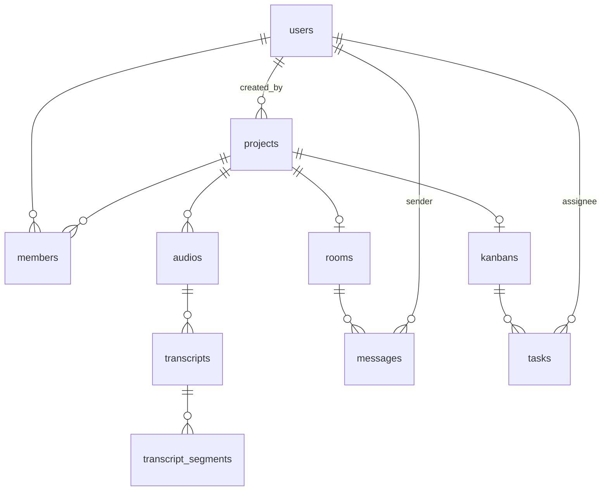

# capture-the-moment (Spring Boot app)

The main application of [Capture the Moment](../README.md). It serves the web UI and owns all persistent state:

- **UI**: server-rendered Thymeleaf pages (`src/main/resources/templates/`) plus `static/js/auth.js`
- **REST API**: accounts, projects, members, audio, transcripts, chat history, Kanban tasks
- **WebSockets**: real-time project chat and Kanban board
- **Storage**: MySQL (JPA/Hibernate) for data, MinIO (S3) for audio files
- **Transcription**: forwards uploaded audio to [`transcription-service`](../transcription-service/README.md) and saves the result

Stack: Spring Boot 4.1, Java 25, Spring MVC + Security + Data JPA + WebSocket, JJWT, MinIO Java SDK, Lombok.

---

## Run locally

**Requires:** JDK 25, plus MySQL and MinIO running from the repo-root `docker-compose.yml`. Transcription also needs the Python service running on port 8000.

```powershell
# from the repo root: start infra once
docker compose up -d

# from capture-the-moment/
.\mvnw.cmd spring-boot:run "-Dspring-boot.run.profiles=local"
```

On macOS or Linux, use `./mvnw spring-boot:run -Dspring-boot.run.profiles=local`.

The app starts on **http://localhost:8080**. **Always use the `local` profile** when running on your machine, because the database and MinIO settings live in `application-local.properties`. Without a profile the app fails at startup with *"Failed to determine a suitable driver class"*.

Other useful commands:

```powershell
.\mvnw.cmd clean compile          # compile only
.\mvnw.cmd package -DskipTests    # build target/*.jar
java -jar target\capture-the-moment-*.jar --spring.profiles.active=local
```

Hibernate creates and updates the tables automatically (`ddl-auto=update`). There are no migration scripts.

---

## Configuration

| File | Used when | Contains |
| --- | --- | --- |
| `application.properties` | always | upload limit (2 GB), JPA, Hikari pool, JWT settings, transcription URL default |
| `application-local.properties` | `local` profile (running on your machine) | `localhost:3307/myapp_local`, `http://localhost:9000`, bucket `capture-the-moment-local`, `http://localhost:8000` |
| `application-docker.properties` | `docker` profile (inside Docker) | the same settings with hostnames `mysql`, `minio`, `transcription-service` |

Environment variables you can override:

| Variable | Default | Purpose |
| --- | --- | --- |
| `JWT_SECRET` | dev placeholder | HS256 signing key, **≥ 32 bytes**. Change it outside local dev |
| `JWT_EXPIRATION` | `PT8H` | Token lifetime (ISO-8601 duration) |
| `TRANSCRIPTION_SERVICE_URL` | `http://localhost:8000` | Python service base URL |
| `SPRING_PROFILES_ACTIVE` | none | `local` or `docker` |

---

## Code layout

Package root: `com.example.capture_the_moment`. Each layer is split by domain (`user`, `project`, `audio`, `chat`, `kanban`), so all code for one feature is easy to find.

```text
CaptureTheMomentApplication.java   entry point

configs/                 Spring @Configuration
  SecurityConfig           public routes, JWT filter, BCrypt, stateless sessions
  WebSocketConfig          registers /ws/chat/{projectId} and /ws/kanban/{projectId}
  MinioConfig              MinioClient bean

security/
  JwtFilter                reads JWT from "Authorization: Bearer" or cookie capture_auth
  JwtUtils                 create / validate HS256 tokens

websocket/
  chat/                    ChatWebSocketHandler, ChatHandshakeInterceptor
  kanban/                  KanbanWebSocketHandler, KanbanHandshakeInterceptor

controllers/             HTTP endpoints (thin: parse request → call service → map response)
  user/                    AuthController (/auth/**), UserController (/u/me)
  project/                 ProjectController (/project/**)
  audio/                   AudioController, TranscriptionSegmentController (/api/**)
  chat/                    ChatController (/project/{id}/chat/history)
  kanban/                  KanbanController (/project/{id}/kanban/tasks)
  views/                   ViewController: Thymeleaf page routes
  exceptions/              ApiExceptionHandler → { error, message } JSON
  dev/                     HealthController, WebClientController (test helpers only)

services/                Business rules and membership/admin checks
  user/                    AuthService (register, UserDetailsService, password, avatar)
  project/                 ProjectService, InviteService
  audio/                   AudioService (MinIO + audio rows), TranscriptionSegmentService
  chat/                    ChatService
  kanban/                  KanbanServices

repository/              Spring Data JPA interfaces, same domain split
entity/                  JPA entities (one MySQL table each), same domain split
dto/                     SignInDTO, ChangePasswordDTO (request bodies)
```

The request path is always **controller → service → repository → entity**. WebSocket handlers call the same services, so access checks are applied the same way.

---

## Data model



| Table | Entity | Notes |
| --- | --- | --- |
| `users` | `entity.user.UserEntity` | BCrypt password; avatar stored as a base64 data URL |
| `projects` | `entity.project.ProjectEntity` | unique `inviteCode` (generated, not yet usable for joining) |
| `members` | `entity.project.Member` (+ `MemberId`) | composite key (user, project); role `ADMIN` / `MEMBER` |
| `audios` | `entity.audio.Audio` | MinIO object key; status `UPLOADED` / `TRANSCRIBED` / `TRANSCRIPTION_FAILED`; unique per project by file name and SHA-256 |
| `transcripts`, `transcript_segments` | `entity.audio.Transcript`, `TranscriptSegment` | language plus ordered segments (speaker, start, end, text) |
| `rooms`, `messages` | `entity.chat.Room`, `Message` | one room per project |
| `kanbans`, `tasks` | `entity.kanban.Kanban`, `Task` | one board per project; status `TODO` / `IN_PROGRESS` / `DONE` |

---

## API reference

Everything except `/`, `/signin`, `/auth/signin`, `/auth/login` and `/js/**` requires a JWT, sent either as cookie `capture_auth` or as `Authorization: Bearer <token>`. Errors are returned as `{ "error": ..., "message": ... }`.

### Pages (Thymeleaf)

`/` (redirects) · `/signin` · `/dashboard` · `/settings` · `/projects/{id}/audios` · `/projects/{id}/transcription` · `/projects/{id}/transcription/{audioId}` · `/projects/{id}/kanban` · `/projects/{id}/chit-chat` · `/projects/{id}/members` · `/projects/{id}/settings`

### Auth and account

| Method | Path | Body / notes |
| --- | --- | --- |
| POST | `/auth/signin` | `{username, password}`: **register** (password ≥ 8 chars) → 201 |
| POST | `/auth/login` | `{username, password}` → sets cookie, returns `{token, redirect}` |
| POST | `/auth/logout` | clears the cookie |
| POST | `/auth/account/avatar` | multipart image, ≤ 2 MB |
| POST | `/auth/account/password` | `{currentPassword, newPassword}` |
| DELETE | `/auth/account` | deletes the current user |
| GET | `/u/me` | `{username}` |

### Projects and members

| Method | Path | Who |
| --- | --- | --- |
| GET | `/project` | your projects |
| POST | `/project` | `{projectName}`: anyone; you become ADMIN |
| PATCH | `/project/{id}` | ADMIN: rename |
| DELETE | `/project/{id}` | ADMIN |
| GET | `/project/{id}/members` | member |
| POST | `/project/{id}/members` | ADMIN: add an existing user by username |

### Audio and transcripts

| Method | Path | Notes |
| --- | --- | --- |
| POST | `/api/project/{id}/audios` | multipart `file`: store in MinIO, transcribe synchronously, save transcript |
| GET | `/api/project/{id}/audios` | list |
| GET | `/api/project/{id}/audios/{audioId}/content` | stream or download the audio |
| GET | `/api/project/{id}/audios/{audioId}/transcription` | transcript with segments |
| DELETE | `/api/project/{id}/audios/{audioId}` | deletes the audio, its transcript and the MinIO object → 204 |
| GET | `/api/project/{id}/transcriptions` | audios that have transcripts |
| POST | `/api/transcribe` | standalone proxy to Python; stores the file in MinIO but **does not** save a transcript |

### Chat

- `GET /project/{id}/chat/history` returns the last 100 messages.
- WebSocket `/ws/chat/{id}`: send `{ "content": "..." }` (≤ 2000 chars). The server pushes `history`, `message`, `presence`, `system` and `error`.

### Kanban

| Method | Path | Body |
| --- | --- | --- |
| GET | `/project/{id}/kanban/tasks` | |
| POST | `/project/{id}/kanban/tasks` | `{title, description, assigneeUsername}` |
| PATCH | `/project/{id}/kanban/tasks/{taskId}` | `{status}`: `TODO` \| `IN_PROGRESS` \| `DONE` |
| DELETE | `/project/{id}/kanban/tasks/{taskId}` | |

WebSocket `/ws/kanban/{id}`:
- The client sends `{type:"create", title, description, assigneeUsername}`, `{type:"status", taskId, status}` or `{type:"delete", taskId}`.
- The server pushes `state` (on connect), `task-created`, `task-updated`, `task-deleted`, `presence` and `error`.

### Dev-only helpers

`GET /api/health`, `GET /api/health/py` (pings Python `/health`) and `GET /client?q=` are for manual testing only.

---

## How transcription is called

`AudioController` builds a `RestClient` against `transcription.service.url` with a 20 s connect timeout and a **45 min read timeout**, then sends the uploaded file as multipart `file` to `POST /transcribe`. `TranscriptionSegmentService` parses the JSON (`language` and `segments[speaker, start, end, text]`) into `Transcript` and `TranscriptSegment` rows.

| Situation | Response |
| --- | --- |
| Python unreachable or timed out | `503` (the audio is still stored) |
| Python returned an error | `502` |
| Bad JSON from Python | audio marked `TRANSCRIPTION_FAILED` |

---

## Tests

```powershell
.\mvnw.cmd test
```

The only test is `CaptureTheMomentApplicationTests.contextLoads`, which starts the full app context. It needs a database. Without the `local` profile and MySQL running it fails with *"Failed to determine a suitable driver class"*.

---

## Docker image

`Dockerfile` is a two-stage build (Maven + Temurin 25, then a JRE 25 runtime) that exposes port 8080. It is not used during development. When running as a container, set `SPRING_PROFILES_ACTIVE=docker`. To publish, use [`../scripts/build-and-publish.ps1`](../scripts/build-and-publish.ps1).
